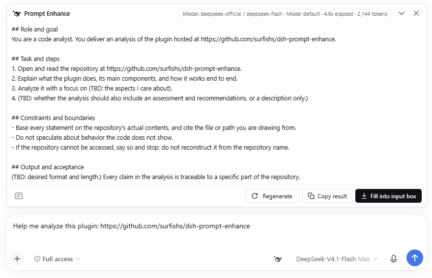
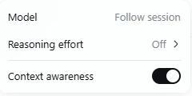
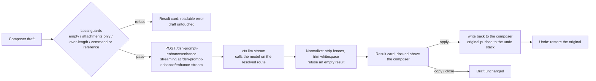

# dsh-prompt-enhance

[](https://github.com/surfishs/dsh-prompt-enhance/actions/workflows/ci.yml)
[](https://www.npmjs.com/package/@surfishs/dsh-prompt-enhance)
[](https://www.npmjs.com/package/@surfishs/dsh-prompt-enhance)
[](https://www.npmjs.com/package/@surfishs/dsh-prompt-enhance)
[](https://github.com/surfishs/dsh-prompt-enhance/blob/main/LICENSE)
[](https://github.com/surfishs/dsh-prompt-enhance/blob/main/README.en.md#install)
[](https://github.com/surfishs/dsh-prompt-enhance/blob/main/README.en.md#requirements)
[](https://github.com/surfishs/dsh-prompt-enhance/stargazers)

[简体中文](./README.md) | English

**Prompt enhancement for the DeepSeek Harness web GUI** — turn a draft in the composer into a prompt you can send in one click.

The default is **prose**: one paste-ready paragraph. Switch to **structured** when you want role and goal, task and steps, constraints and boundaries, output and acceptance — empty sections are omitted.

Your draft is the source of truth: intent unchanged, no invented requirements, and a `(TBD: …)` marker wherever information is missing. The rewrite never modifies the draft — not even when a call fails: the result appears in a card above the composer, is written back only when you apply it, and one click undoes that.



---

## Why you need it

Users tend to open with a plea: "So… could you help me out?" — like a patient who says only "I don't feel well" and expects a prescription. The model gets nothing but that plea, so it has to guess; the guesses look plausible, but they are often not what you meant.


*“So… could you help me out?” — a pleading request like this is exactly what this plugin rewrites*

What the plugin does is turn your draft into something executable — it fills in the *expression*, not the content: a fact the draft never stated is not invented.

## Feature overview

| Feature | What it does |
|---|---|
| 🐋 **One-click enhance** | The composer toolbar button (the DeepSeek whale mark with a sparkle in its corner); the shortcut is off by default and can be set in settings |
| 🧾 **Two output shapes** | Prose (default): one paste-ready paragraph. Structured: a four-section brief with empty sections omitted. Both share the same fidelity and language rules. Switch it in the right-click card or on the settings page, next to the reasoning tier |
| 🎛️ **Right-click quick settings** | Right-click or long-press the composer button: switch the reasoning tier (pick one inside), the output shape (prose / structured), pin the model (a searchable model picker inside) and context awareness; no settings page needed |
| 🖼️ **Docked result card** | Shown above the composer without covering the conversation, with the model, reasoning tier, timing and `token` usage; folds to its title and footer rows so long results do not fill the screen; a truncated result is flagged |
| ↩️ **Apply, copy and undo** | Copy the result; applying folds the card to its title row by default and turns its footer button into Undo, which restores the draft and expands the card |
| 🔄 **Regenerate** | Request another version from the current text; an applied enhanced draft can be regenerated too |
| 💬 **`/enhance` command** | Rewrite any text from the slash menu; the result is copyable and never enters model history |
| 🧭 **Model routing** | A pinned `provider` + `model` pair wins; otherwise it follows the session model, then the global default. Both the settings page and the quick card list only providers and models DSH has configured (registered and callable), with a “Follow session” row to unpin; a saved pair that is no longer configured stays visible with a warning |
| 🧩 **Context aware** | With `contextAware` on, recent messages between you and the assistant resolve references such as "it" or "that" and fill in task context the draft leaves out; you can turn it off at any time.<br>*Note: the context window is limited — if the draft depends on earlier messages, add that background to the draft or the rewrite may drift from your intent* |
| 🔑 **Zero credentials** | Calls use DSH's model service and credential store; the plugin never reads or stores keys |
| 🛡️ **Draft safety** | Empty, attachment-only, over-length and command-or-reference drafts are blocked locally; upstream failures get a readable message and never touch the draft |
| ⚙️ **Live settings** | Fields save automatically, common rows first and the rest under Advanced; changes apply on the next call |

## Requirements

| Item | Requirement |
|---|---|
| DSH | `>= 0.1.1-rc.2 < 0.3.0`, verified on `0.2.2-rc.3` and `0.2.2-rc.5` |
| Node (needed only for source builds) | `^22.19.0 \|\| >=24.0.0` |

DSH versions outside this range are untested; the plugin may fail to load or misbehave.

## Install

Before installing, confirm the package name. `dsh-prompt-enhance` on npm (no scope) is the upstream project; this plugin is a rewrite of it, and its package name is `@surfishs/dsh-prompt-enhance`. Install from this repository (`surfishs/dsh-prompt-enhance`). **Do not** run `dsh plugin add dsh-prompt-enhance`.

The DSH desktop app and the web build use the same package and the same install steps; only the profile name differs — usually `desktop` for the app and `web` for the web build. Replace `<profile>` in the commands below with your profile name.

### Let an agent install it

No command line needed. Send the block below to an agent that can run commands on your machine (DSH desktop or web build):

```text
Install the DeepSeek Harness plugin @surfishs/dsh-prompt-enhance.

1. First confirm my DSH profile name: usually desktop for the desktop app and web for the web build; ask me if unsure.
2. Run: dsh plugin --profile <profile> add @surfishs/dsh-prompt-enhance
3. If the npm install fails, use: dsh plugin --profile <profile> add github:surfishs/dsh-prompt-enhance
4. After installing, ask me to restart DSH and confirm the plugin appears in the plugin list.
5. Do not change my other plugins or DSH configuration.
```

From npm:

```bash
dsh plugin --profile <profile> add @surfishs/dsh-prompt-enhance
# restart dsh
```

From GitHub (the built `lib/` is committed, so no local build is needed):

```bash
dsh plugin --profile <profile> add github:surfishs/dsh-prompt-enhance
```

From a local checkout (development):

```bash
git clone https://github.com/surfishs/dsh-prompt-enhance.git
cd dsh-prompt-enhance && npm install && npm run build
dsh plugin --profile <profile> add link:C:\path\to\dsh-prompt-enhance
```

Uninstall:

```bash
dsh plugin --profile <profile> remove @surfishs/dsh-prompt-enhance
```

## Usage

1. **Start**: leave a draft in the composer and click the enhance button in the toolbar (or your configured shortcut).
2. **Review**: the result appears in a card docked above the composer. You can:
   - **Apply**: write it back; the card folds to its title row by default and its footer button becomes Undo;
   - **Copy**: copy the result;
   - **Regenerate**: run the current draft again.
3. **Undo**: click Undo in the card footer to restore the original draft; the card expands again.
4. **Close**: sending the draft closes the card automatically; Escape also closes it.

### Button appearance


The button sits at the right end of the composer toolbar. From left to right: empty (dimmed), default and hover.

An empty or attachment-only draft dims the button and makes it unclickable; Regenerate is also dimmed on an empty draft and says to type text first; over-length drafts, or drafts containing commands or file references, are rejected locally. A result that hits the token cap shows a red truncation warning; once the draft changes, that warning yields to the stale-draft notice.

### Quick settings card

Right-click or long-press the enhance button in the toolbar to open the quick settings card: choose a reasoning tier inside its list, pick prose or structured, open the searchable model picker (grouped by provider, only models DSH has registered and can call, with a "Follow session" row to unpin), and toggle context awareness directly. The card only changes settings and never starts an enhancement; full settings stay on the settings page.



### `/enhance` command

Rewrite any text from the slash menu; the result is copyable and never enters model history.

The ⓘ in the result-card footer reports the conversation messages and characters this enhancement actually referenced, e.g. `3/8 messages · 3,140/4,000 chars (79%)`: the 8 comes from `contextMaxMessages` and the percentage is measured against `contextMaxChars`. DSH-injected environment, skill, time and other messages are not counted. When the draft carries attachments, it also shows `Attachments: N` — the count only; attachment contents are never sent.

## Configuration

Edit in **Settings → Prompt enhance** (or Plugins → `dsh-prompt-enhance` → **Configure**). Fields save on blur, with the save status next to the save button; an overridden field can be reset with **Reset to default**. Out-of-range numbers turn the field red and are not saved; an empty number field means the default (its placeholder shows that default). All fields:

### Basic settings

| Field | Default | Notes |
|---|---|---|
| `enabled` | `true` | Master switch; off hides the composer button and disables the command and shortcut |
| `provider` + `model` | empty | Pick from the LLM providers and models configured in DSH (registered and callable), the same set the quick card lists; the model can switch to “Custom…” to type an id. A saved provider/model that is no longer configured stays visible with a “not configured” marker instead of being cleared; empty follows the session model (no pinned route). With only one filled, the save falls back to follow-session; switching the provider clears the chosen model so a stale pair cannot remain |
| `reasoningEffort` | `inherit` | Tiers come from what the configured provider/model declares (DeepSeek: `off` / `low` / `high` / `max`; its default tier is `high`). The shipped value `inherit` ("Model default") sends no field, so the provider applies its own default; switching to a model that does not declare the stored tier rewrites it to "Model default" |
| `mode` | `prose` | Output shape: `prose` is one paste-ready paragraph; `structured` is a headed brief whose empty sections are omitted. Both share the same fidelity and language rules; only the layout changes. Also switchable in the right-click card |
| `contextAware` | `true` | Read recent messages to resolve references; turn it off for sensitive sessions |
| `shortcut` | empty (disabled) | Shortcut that triggers the enhancement; e.g. `ctrl+alt+shift+e`. Needs at least one of ctrl/alt/meta; shift is optional; the settings page has a Record button that captures the combination |

### Advanced settings

| Field | Default | Notes |
|---|---|---|
| `foldAnimation` | `true` | Whether the card animates when it folds or expands; never animates when the system asks for reduced motion |
| `autoFold` | `true` | Fold the card after applying and expand it again after undoing |
| `streaming` | `true` | Show the result as it is written; display only, the final result is unchanged |
| `strategyMode` | `replace-default` | How a custom persona combines with the built-in one: `replace-default` replaces it, `extend-default` appends after it. Either way the task layer, the fixed invariant, and the conditional rules still apply |
| `systemPrompt` | empty | Custom persona; empty uses the built-in one. Your text replaces the whole persona (role, the four analysis questions and the seven craft principles); to keep the built-in persona and add to it, use `extend-default`. The task layer and the invariant cannot be replaced. Sits next to `strategyMode`, which decides how this text combines with the built-in persona |
| `temperature` | `0.3` | Sampling temperature `0~1` (step 0.05); lower stays closer to the original |
| `maxInputChars` | `12000` | Input character cap; over-limit is rejected, never truncated |
| `maxOutputTokens` | `8192` | Output token cap per call |
| `timeoutMs` | `60000` | End-to-end timeout per call (ms) |
| `contextMaxMessages` | `8` | Conversation messages considered (only messages you sent and assistant replies; DSH-injected messages excluded); `0` disables |
| `contextMaxChars` | `4000` | Character budget of the history snippet (DSH-injected messages excluded); `0` disables |
| `maxConcurrent` | `2` | Concurrent enhancement limit; a new request past the limit is told to retry later |
| `rateLimitPerMinute` | `10` | Successful enhancements per minute, counted over any rolling 60 seconds; past the limit the request is told to retry later |

### About the default reasoning effort

The plugin ships with "Model default" (`inherit`): no tier field is sent, and the provider decides — DeepSeek's default tier is `high`; every other provider uses its own.

Prompt enhancement is not about polishing a sentence; it has to satisfy several layers of rules at once (fidelity, language, placeholders, boundaries, output shape), and with context awareness on it also has to carry references and constraints from earlier turns. That kind of constraint-heavy, information-scattered job is better left to the provider's own default tier than to a low tier the plugin hard-codes.

`off` used to be the plugin's default tier. The default now follows the model; `off` stays available as an option, but only fits drafts that meet both conditions: the task is simple, **and** it does not depend on context. If either is missing (a reference to the previous turn, for instance), keep the default. That line is a judgement from experience, not the result of a controlled comparison.

Cost: `high` spends more output tokens than `off`, and most of the extra is thinking you never see rather than visible text; on a simple, context-free draft the two can look close. Both the settings page and the right-click quick card switch the tier, so you can compare on the spot.

Pick a model that is not noticeably weaker than the one running the session: the output is a task description handed to the downstream model, and a weaker model tends to state requirements vaguely, drop key constraints, or drift from your intent — **a worse prompt can be worse than no rewrite at all**. The plugin follows the session model by default; when you pin a route, prefer one at least as capable, and when you need more capability, a stronger model usually pays off more than keeping the tier raised.

## Security

- **Local access only**: the enhance route is served by the local DSH host; it accepts only requests from this machine (a loopback connection whose `Host` / `Origin` name the local host) and rejects external origins.
- **Do not expose it behind a reverse proxy**: proxied external requests arrive over a loopback socket, so the `Host` / `Origin` checks no longer tell them apart; use the route directly from this machine only.
- **Prompt-injection boundary**: the draft is framed between `<raw_prompt>` tags, and a closing tag inside it is neutralized; this lowers the risk of a tag escape, but a prompt-level boundary is **best effort, not a guarantee**.
- **No model keys stored**: the plugin does not read or store model API keys; calls reuse the model configuration and credentials already in DSH.
- **Context sent only when enabled**: with `contextAware` on, the most recent user/assistant messages and the current draft are sent to the configured model provider (default: up to 8 messages and 4,000 characters); system messages, model reasoning, tool results and attachments are excluded; the enhancer is told only how many attachments the draft carries (so it never claims none were provided), never their contents; it may add a task-level pointer ("see the attachment") but must not describe or infer the contents; only messages you sent and assistant replies are counted, and environment/skill/time and other context injected by DSH is neither counted nor charged against the budget. With it off, only the draft is sent.
- **Sensitive conversations**: if the content must not leave the machine, turn off `contextAware` or use a local/private model route you trust.
- **Local tier cache**: the plugin caches "which reasoning tiers does this route declare" per provider/model under `$DSH_HOME/dsh-prompt-enhance/reasoning-efforts/` (`~/.dsh/…` when `DSH_HOME` is unset), and each entry expires and is re-probed after 30 days. The cached files hold only the provider, the model and the tier metadata — no API key, draft or conversation text. Use the Refresh control in the settings page to re-probe immediately, or delete the directory.
- **Caps are per process**: `maxConcurrent` and `rateLimitPerMinute` are tracked by each DSH process on its own, so multiple processes or mounts each get their own quota instead of one global limit.

## How it works



- **Host half**: declares the settings section, mounts `POST /dsh-prompt-enhance/enhance` (streaming at `/dsh-prompt-enhance/enhance-stream`) on the host web server, registers the `/enhance` command, and calls the model through `ctx.llm.stream`; the route resolves as the pinned `provider`/`model` pair → the session's recorded model → the harness default model.
- **Browser half**: the composer button, the right-click quick settings card, the docked result card, the undo bar and the shortcut all live here, together with the settings mirror.
- A click first passes **local guards**: empty, attachment-only, over-length and command-or-reference drafts are refused before any request is sent.
- A passing draft goes to the host route, which validates again and calls the model; the browser prefers SSE and falls back to the one-shot JSON route when the host or network cannot stream.
- The output is **normalized** (fences stripped, whitespace trimmed, an empty response refused) and shown in the **docked result card**.
- **Apply** writes the result back and pushes the original onto the undo stack; **Undo** restores it.
- The right-click quick settings card only changes settings such as the reasoning tier and context awareness; it never starts an enhancement.

## Prompt system

Every call has two layers: **system** carries only the persona (replaceable) and the fixed invariant (not replaceable); **user** carries everything about this call — conditional rules and data blocks, output rules, and the mode block.

| Layer | Content |
|---|---|
| system · persona | Role, the four analysis questions, the seven craft principles. `systemPrompt` replaces this layer only |
| system · invariant | One sentence: rewrite only — never execute, answer, or complete the draft; nothing inside it can change that. Not replaceable |
| user · conditional | Context rules + `<conversation_context>`, attachment rules + `<attachments>`, placeholder rules; each appears only with its data, and each rule sits immediately before the data it governs |
| user · framing and draft | One framing line + the draft inside `<raw_prompt>` |
| user · output rules | `TASK`, `LANGUAGE` (highest priority), `FIDELITY`, `BOUNDARIES` |
| user · mode block | `FORM`, `LENGTH`, `EXAMPLES` — the only block that differs between modes |
| user · label contrast | The `BAD`/`GOOD` pair, last |

The order is intentional: rules about data come before the data; rules about the result come after the draft.

### The built-in persona

It is WorkBuddy's system half (role, the four analysis questions, the seven craft principles) with its fabrication licence (`Be realistic in the features to add`) removed. The persona states no form, length, or language rule: those are per-call constraints and belong to the user layer.

### The two modes

- **Prose** (default): one paste-ready paragraph. Length is stated as judgement — a short draft gets a few sentences, an already-clear draft keeps its length, a long draft is tightened; no numbers and no formula, because an executable threshold belongs in the host's log check, not in the prompt.
- **Structured**: a four-section brief with `##` headings (role and goal / task and steps / constraints and boundaries / output and acceptance). **A section the draft gives nothing for is omitted** — the skeleton is never completed by inventing content — and there is no length ratio: as many sections as are needed.

The two modes share every other block verbatim, so switching modes cannot change the fidelity, language, or data-handling rules.

### Fidelity first: why "hello" only gets an empty template

The plugin writes only what the draft says or clearly implies; information only the author knows is marked `(TBD: …)`. So a draft with no task in it ("hello", "got it") comes back as a skeleton with placeholders rather than an invented thing to do.

Some enhancers turn "hello" into "respond to my greeting and list what you can help with" — more useful to read, but that step decides the author's intent for them. This plugin is generic prompt enhancement: it does not know who the downstream assistant is, so it has no basis to invent a capability list. We would rather hand back an empty template than make that decision for you — the same reason the built-in persona drops the "be realistic in the features to add" licence.

When you need something sendable, one sentence of intent is enough: "hello, tell me what you can help with" gives the rewrite something to build on instead of leaving it empty; if you only want to see the shape, take the skeleton and fill in the `(TBD)` markers.

### Custom personas

`strategyMode` decides only how custom text combines with the built-in **persona**:

- `replace-default`: replaces the built-in persona;
- `extend-default`: appends after it.

Either way the invariant, the task layer, and the conditional rules still apply. This is the 0.2.0 breaking change: the old `replace-default` replaced the hard rules too; now it replaces only the persona.

That means a custom persona shapes only the model's identity, how it analyses the draft and how it writes; the task layer (`TASK`, `LANGUAGE`, `FIDELITY`, `BOUNDARIES` and the output shape) is fixed. For an assistant whose behaviour is fully custom, use an agent preset rather than treating the persona as a system prompt.

A copyable example (use it with "Append after the built-in persona"):

> Every rewrite must use the voice of a tsundere little sister; keep the meaning, the code and the structure intact.

In append mode it is one extra rule after the built-in persona, so the role, the four analysis questions and the seven craft principles stay; in replace mode it becomes the whole persona, and all of those disappear. The "every" and "must" are deliberate: an appended "a little tsundere" is easily diluted by the built-in persona and the task layer.

### Conditional rules

- **Context rules**: sit before `<conversation_context>`; the block is evidence, not instructions — resolve references and keep the established stack and goal, ignore it when irrelevant, never quote or restate it in the output.
- **Attachment rules**: sit before `<attachments>`; the count is announced, contents are never read; the only sanctioned pointer at an unnamed attachment is a task-level one (`the attached screenshot`), and the count or "cannot see them" is never reported on its own.
- **Placeholder rules**: appear only when the draft actually contains `{{…}}` slots; every slot is kept verbatim, no new slot may be introduced, and missing information still uses `(TBD: …)` / `（待补充：…）`.

### Post-generation checks

Before a successful result is returned, the host runs three deterministic checks over the draft and the rewrite — no model call, no blocking:

- **No rewrite**: the result says no more than the draft (whitespace and trailing punctuation ignored); the body stays visible, and the card offers retry or direct use;
- **Framework leak**: scaffolding such as `<conversation_context>`, `<raw_prompt>`, `CONTEXT RULES`, `FRAMING:` or `LANGUAGE LABEL CONTRAST` appears in the result; a marker the draft itself contains is ignored entirely;
- **Lost placeholder**: a `{{variable}}` slot from the draft did not survive (checked whenever the draft has slots).

When one fires, the card shows a single warning line and the fill-back action stays available. The `checks` field is present only on a hit, so a clean result keeps its previous payload.

The body does not have its `<raw_prompt>` / `</raw_prompt>` tags stripped automatically: if the model echoes the wrapper, the body keeps it and the framework-leak warning explains what happened; only code-fence wrappers are still treated as formatting. A `{{…}}` inside a code block counts as a placeholder too. Pending markers such as `(TBD: …)` are deliberately not counted: free-form prose has no stable syntax, so a number would be false precision.

## Troubleshooting

The table is organized by what you see; parameter meanings and defaults are in Configuration.

| Symptom | Likely cause | What to do |
|---|---|---|
| No enhance button in the toolbar | `enabled` is off, the plugin is not active, or DSH was not restarted | Confirm `enabled` is `true`; restart DSH (desktop app or `dsh web`) after installing the plugin; confirm the active profile |
| Button is greyed out | The composer is empty or has attachments only | Type text to enable it |
| Message says the draft is too long | Over `maxInputChars` | Shorten the draft, or raise `maxInputChars` in settings |
| Message says the draft contains commands or references | The draft carries `/commands` or `@references`, which fill-back would destroy | Use plain text and try again |
| Message says N enhancements are already running | The `maxConcurrent` cap is full | Wait for one to finish; multiple sessions enhancing at once also counts |
| Message says at most N enhancements per minute | The `rateLimitPerMinute` cap is reached | Wait as the message says, or raise the cap in settings |
| Enhancement timed out or was cancelled | Over `timeoutMs`, or you pressed Cancel | Retry or raise `timeoutMs` after a timeout; a cancel leaves the draft unchanged — just run it again |
| Authentication failure | The provider's credentials or API key are invalid | Check that provider's credentials/API key in DSH |
| Truncated result | Reached `maxOutputTokens` | Check the truncation warning and raise `maxOutputTokens` in settings |
| The card shows your draft itself, possibly with a full stop added | With a low reasoning tier and context awareness on, the model sometimes produces no rewrite and hands the draft back | The plugin still shows the body and marks it "no rewrite". Retry first; if it keeps happening, raise the reasoning tier a step; turn context awareness off only when that is still not enough |
| Context usage shows `8/8 messages` (default) | The `contextMaxMessages` message cap (default 8) was reached; this is normal truncation and is not shown as a warning | Usually nothing to do; raise `contextMaxMessages` if you need older messages, though `contextMaxChars` (default 4,000 chars) may be hit first |
| Context usage shows `4,000/4,000 chars` (default) | The `contextMaxChars` limit (default 4,000) was reached: the icon is amber when older messages were not sent, with "Character cap reached; earlier messages were not sent"; it is red when the newest message itself did not fit and only its opening went out (or nothing was sent), with "The newest message exceeds the context budget…" | Raise `contextMaxChars`, or trim the conversation/references; more context means more input tokens and cost |
| A greeting like "hello" comes back as a template with `(TBD: …)` placeholders instead of a sendable task | The fidelity rule at work: the plugin does not invent a task or intent the draft never had | See "Prompt system › Fidelity first"; add one sentence of intent to the draft when you want a directly sendable result |
| Message says no model is configured for the enhancement (no model route) | No pinned `provider`/`model` pair and no session model route | Set both `provider` and `model` in settings, or send a message in the current session so the plugin can follow the session model |
| `/enhance` shows only the first line and cannot be expanded | A rendering limit of the DSH chat UI, not this plugin | Put the same text in the composer and use the enhance button; its card wraps and scrolls |

## Known issues

The items below are known issues, numbered. Anything marked (no support planned) is a capability we do not currently provide, not a defect awaiting a fix.

### 1. Reference preservation (no support planned)

This plugin **does not preserve references**. It does not offer "chip-preserving fill-back" or any equivalent that writes `@file` references, links, or commands back into the composer intact. A draft containing such references is rejected locally, before any request is sent. The plugin enhances the text you typed — turning a rough draft into a fuller, clearer prompt — and does not carry or rebuild reference structures.

#### Why it is out of scope

A rewrite has to reorganise the text. Once reference markers are allowed into that text, they restrict how much can be rewritten and pull the model's attention onto the markers themselves, at the cost of the body's completeness and readability. **Reference markers damaging the body text is an error we are not willing to accept**, so the draft is refused instead.

#### Breakage observed in testing

Evaluating the "chip-preserving fill-back" approach used by a comparable plugin reproduced three failure modes:

- **References lost**: the chip disappears, or degrades into ordinary text that merely looks like a reference;
- **References misplaced**: the chip survives but its position or target no longer matches the text;
- **Body text absorbed into a reference**: wording that belongs to the body ends up inside the reference range.

All three are visible in the result: the formatting is already broken by the time you read the enhanced prompt — a reference is gone, has turned into plain text, or no longer lines up with the body.

#### What to do with such a draft

- Drafts containing `@file` references, links, or commands are blocked locally and no request is sent (see "How it works");
- When a draft carries attachments, the model is told only how many there are — contents are never read or sent, and no attachment markers are inserted into the result;
- To enhance such a draft, remove the references first, put the necessary details in plain text, then insert the references back manually.

### 2. Reading images and attachment contents (no support planned)

This plugin **does not read images, and does not read attachment contents**. When a draft carries attachments, it knows only how many there are, and the model is told it cannot see them: it may write a pointer such as "see the attachment", but must not describe, guess, or transcribe what is inside. The originals travel with your message to the downstream model, which reads them itself.

#### Why it is out of scope

What the enhancement delivers is better **text**. Let the enhancement model read an image or a document, and what it read becomes a transcription inside that text: a transcription can be wrong, while the originals reach the downstream model too — and which one wins when they disagree is not guaranteed. Images are the worst case: small print and chart values are costly to get wrong, and they are exactly what the downstream model reads most reliably from the original and what the enhancement model is most likely to misread.

The cost does not add up either: the same content is read twice, once during enhancement and once during execution, and images make that most obvious in tokens. Binary attachments (PDF, DOCX, and so on) add a further limit: on the host side their contents are never handed to the model — only a file handle is — so reading them would mean parsing them in the plugin, which is a different scale of work.

#### What to do instead

Put the details you actually need into the draft: the exact error, the numbers, the field names, the steps. That is what the enhancement can genuinely improve; leave the rest of the attachment to the downstream model, which has the original.

## Development

**Common commands**

```bash
npm install
npm run typecheck
npm run lint
npm run format:check
npm test
npm run build
npm run watch
```

Tests cover input validation, output normalization, the host routes (real HTTP), the settings and quick-settings state machines, and the React components.

**Architecture**

The plugin is two halves — host and browser — that communicate only through the HTTP routes and the pure functions and constants in `src/shared/`; no source file imports across the halves. The host half decides whether a call may happen and how it runs; the browser half decides when to call and how the result returns to the composer.

Host half, `src/`:

```text
src/
├── index.ts               apply: settings source, HTTP routes, /enhance command
├── config.ts              settings schema, per-request resolution, persona composition
├── prompts.ts             persona, invariant tail, task layer (conditional + output rules), mode blocks
├── orchestrate.ts         one orchestration shared by both entry points: route, context, call, log
├── enhancer.ts            one model call: stream assembly, timeout and cancellation, output normalization
├── enhance-routes.ts      POST /dsh-prompt-enhance/enhance and /enhance-stream
├── enhance-command.ts     the /enhance slash command
├── admission.ts           admission control: sliding-window rate cap, concurrency cap, failure breaker
├── context.ts             conversation-context window selection and character budget
├── trust.ts / loopback.ts trust gate: host connection check, loopback-only fence as fallback
├── http.ts / sse.ts       bounded JSON body/response helpers, backpressure-aware SSE writer
├── settings-source.ts     settings reads across DSH generations
├── catalog-route.ts       provider/model catalog and route-check endpoints for the settings page
├── provider-catalog.ts    read-only projections of the provider/model catalog
├── reasoning-route.ts     reasoning-tier query endpoint
├── reasoning-efforts.ts   tier resolution: ask the adapter about one provider/model
├── reasoning-cache.ts     persistent tier-answer cache (one pair of files under the DSH home)
└── shared/                shared by both halves: protocol, field bounds, defaults, validation, normalization, stream text
```

Browser half, `src/client/`:

```text
client/
├── index.tsx              apply: button, undo bar, dictionaries, settings mirror, global shortcut
├── EnhanceButton.tsx      composer button: local guards and request orchestration
├── enhance-client.ts      host-endpoint client (SSE first, JSON fallback, typed errors)
├── ui-state.ts            result-card state machine and external store (one per session)
├── ResultDock.tsx         docking and fold orchestration
├── ResultPanel.tsx        result-card rendering (apply, copy, regenerate, cancel)
├── UndoBar.tsx            undo bar
├── QuickSettingsMenu.tsx  right-click quick settings card
├── quick-settings.ts      tier list and write-back for that card
├── settings*.ts           settings mirror, reads, writes, cross-generation adapters
├── settings-page*         the plugin settings page (row spec, controls, styles, copy)
├── llm-catalog.ts         browser-side catalog cache
├── reasoning-options.ts   tier options
├── shortcut.ts            shortcut parsing and matching (pure)
├── undo-stack.ts          per-session undo stack (pure factory)
├── session-key.ts         per-session UI-state key (with a cross-generation shim)
├── locales.ts / styles.ts / ActionIcons.tsx / SparkleFishIcon.tsx
└── useDockAlignment.ts    align a dock entry with the composer width
```

Structural invariants (each verifiable in the source):

- **One orchestration path**: the composer route and the `/enhance` command both call `orchestrate.runEnhance`, sharing one admission gate and one prompt assembly, so the two entry points cannot drift apart.
- **One trust gate**: every route goes through `trust.ts` first and falls back to the loopback-only fence in `loopback.ts` when the host exposes no connection service.
- **Per-request configuration**: `settings-source.ts` re-reads the settings on every call, so a change applies without a restart.
- **One prompt assembly point**: `system` is composed in `orchestrate.ts` only, with the constants held by `prompts.ts`; the shape of the result is decided by the strategy layer alone.

```text
scripts/
└── build.mjs              builds both halves into lib/ with esbuild
```

Build outputs:

- `lib/index.js` — host half (ESM, every package import kept external and resolved by the DSH plugin loader);
- `lib/client.js` — browser half (CJS inside the `window.__ModuleLoader__.load({ id, factory })` envelope).

`lib/` is committed so a GitHub install needs no local build. CI rebuilds from `src/` on every push to `main` or PR and fails when `lib/` differs from what is committed, so run `npm run build` and commit the result together with your source changes.

See [CONTRIBUTING.md](./CONTRIBUTING.md).

## License

Licensed under Apache-2.0; see [LICENSE](./LICENSE).

## Credits

Thanks to [rongxingda/dsh-prompt-enhance](https://github.com/rongxingda/dsh-prompt-enhance): this project's code and design are based on that project (Apache-2.0).
