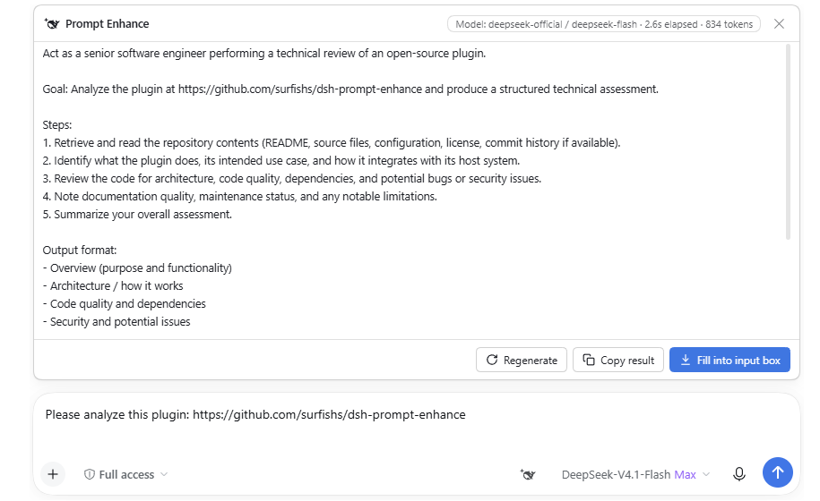

# dsh-prompt-enhance

[](https://github.com/surfishs/dsh-prompt-enhance/actions/workflows/ci.yml)
[](https://www.npmjs.com/package/@surfishs/dsh-prompt-enhance)
[](./LICENSE)

**Prompt enhancement for the DeepSeek Harness web GUI** — turn a composer draft into a structured prompt (role and goal, executable steps, output format, acceptance criteria, edge cases) in one click. The original draft is preserved, and a failure never touches it.

[简体中文](./README.md) | English



---

## Features

| Feature | What it does |
|---|---|
| 🐟 **One-click enhance** | The composer toolbar button (the DeepSeek fish mark whose upper-left corner carries a sparkle); the shortcut is off by default and can be set in the settings |
| 🖼️ **Docked result card** | The result appears above the composer without covering the conversation, with the model, timing and `token` usage; a truncated result is marked as possibly incomplete |
| ↩️ **Apply, copy and undo** | Undo right after applying; once the card is closed, the undo bar remains above the composer |
| 🔄 **Regenerate** | Requests another version from the current composer text; after applying, it regenerates the enhanced draft as well |
| 💬 **`/enhance` command** | Rewrites any text from the slash menu; the result never enters model history |
| 🧭 **Model routing** | A pinned `provider` + `model` pair wins; otherwise it follows the current session model, then the global default model |
| 🧩 **Context aware** | With `contextAware` on, recent turns resolve references such as "it" or "that"; it can be turned off |
| 🔑 **Zero credentials** | Calls go through the harness LLM service and its credential store; the plugin neither reads nor stores keys |
| 🛡️ **Draft safety** | Empty, attachment-only, over-length and command-or-reference drafts are blocked locally before any request; upstream failures map to readable messages; a failure never touches the draft |
| ⚙️ **Live settings** | Fields save automatically, common rows come first and the rest fold into Advanced settings; changes apply to the next call with no restart |

## Requirements

| Item | Requirement |
|---|---|
| dsh | `>= 0.1.1-rc.2 < 0.3.0`, verified on `0.2.2-rc.3` |
| Node (source builds only) | `^22.19.0 \|\| >=24.0.0` |

## Install

Check the package name first. `dsh-prompt-enhance` on npm (no scope) is the upstream project and this plugin is a rewrite of it; this plugin is `@surfishs/dsh-prompt-enhance`. Install from this repository (`surfishs/dsh-prompt-enhance`) or its entry in the plugin market. **Do not** run `dsh plugin add dsh-prompt-enhance`.

### Let an agent install it

No command line needed. Send the block below to an agent that can run commands on your machine (DSH desktop or web):

```text
Install the DeepSeek Harness plugin @surfishs/dsh-prompt-enhance.

1. First confirm my DSH profile name: usually desktop for the desktop app and web for the web build; ask me if unsure.
2. Run: dsh plugin --profile <profile> add @surfishs/dsh-prompt-enhance
3. If the npm install fails, use: dsh plugin --profile <profile> add github:surfishs/dsh-prompt-enhance
4. After installing, ask me to restart DSH and confirm the plugin appears in the plugin list.
5. Do not change my other plugins or DSH configuration.
```

From npm:

```bash
dsh plugin --profile <profile> add @surfishs/dsh-prompt-enhance
# restart dsh
```

> Replace `<profile>` with your profile name: usually `desktop` for the desktop app and `web` for the web build.

From GitHub (the built `lib/` is committed, so no local build happens):

```bash
dsh plugin --profile <profile> add github:surfishs/dsh-prompt-enhance
```

From a local checkout (development):

```bash
git clone https://github.com/surfishs/dsh-prompt-enhance.git
cd dsh-prompt-enhance && npm install && npm run build
dsh plugin --profile <profile> add link:C:\path\to\dsh-prompt-enhance
```

Uninstall:

```bash
dsh plugin --profile <profile> remove @surfishs/dsh-prompt-enhance
```

## Usage

1. **Start**: leave a draft in the composer and click the enhance button in the toolbar (or your configured shortcut).
2. **Review**: the result appears in a card docked above the composer. You can:
   - **Apply**: write it back; the card stays open with a Replaced chip;
   - **Copy**: copy the result;
   - **Regenerate**: run the current draft again.
3. **Undo**: after applying, click Undo to restore; after closing the card, the undo bar remains above the composer.
4. **Close**: sending the draft closes the card automatically; Escape also closes it.

An empty or attachment-only draft dims the button and makes it unclickable; over-length drafts and drafts containing commands or file references are rejected locally. A result that hits the token cap is marked as possibly incomplete.

`/enhance <text>`: rewrite any text from the slash menu; the result is copyable and never enters model history.

## Configuration

Edit in **Settings → dsh-prompt-enhance** (or Plugins → `dsh-prompt-enhance` → **Configure**). All fields:

| Field | Default | Notes |
|---|---|---|
| `enabled` | `true` | Master switch; off hides the composer button and disables the command and shortcut |
| `provider` + `model` | empty | Pick from the DSH-registered LLM providers and their models; the model can switch to “Custom…” to type an id; unconfigured providers are greyed out until set up in DSH model services; empty follows the session model (none). With only one filled, the save falls back to follow-session |
| `temperature` | `0.3` | Sampling temperature `0~1` (step 0.05); lower stays closer to the original |
| `reasoningEffort` | `off` | Tiers come from what the configured provider/model declares (DeepSeek: `off` / `low` / `high` / `max`). A route that declares no tiers omits the field (follows the provider default); `inherit` means the field is not sent |
| `maxOutputTokens` | `8192` | Output token cap per call |
| `maxInputChars` | `12000` | Input character cap; over-limit is rejected, never truncated |
| `timeoutMs` | `60000` | End-to-end timeout per call (ms) |
| `systemPrompt` | empty | Custom system prompt; empty uses the built-in strategy |
| `strategyMode` | `replace-default` | `replace-default` replaces the built-in strategy (the minimal output contract still applies); `extend-default` appends the custom strategy after the built-in one |
| `shortcut` | empty (disabled) | Trigger shortcut; e.g. `ctrl+alt+shift+e`. Needs at least one of ctrl/alt/meta; shift is optional |
| `streaming` | `true` | Show the result as it is written; display only, the final result is unchanged |
| `contextAware` | `true` | Read recent conversation to resolve references; turn it off for sensitive sessions |
| `contextMaxMessages` | `8` | Number of recent messages considered; `0` disables |
| `contextMaxChars` | `4000` | Character budget of the history snippet; `0` disables |
| `maxConcurrent` | `2` | Concurrent enhancement limit; a new request past the limit is told to retry later |
| `rateLimitPerMinute` | `10` | Successful enhancements per minute (sliding window); past the limit the request is told to retry later |

An empty or attachment-only draft dims the button and starts no request; raise `maxOutputTokens` when a result is truncated.

## Security

- **Local access only**: the enhance route is served by the local DSH host and accepts only loopback addresses and local `Host` / `Origin` values, not external origins.
- **No model keys stored**: the plugin does not read or store model API keys; calls use the host's existing LLM configuration.
- **Context sent only when enabled**: with `contextAware` on, the most recent user/assistant text and the current draft are sent to the configured model provider (default: up to 8 messages and 4,000 characters); system messages, reasoning, tool results and attachments are excluded. With it off, only the draft is sent.
- **Sensitive conversations**: if the content must not leave the machine, turn off `contextAware` or use a local/private model route you trust.
- **Local tier cache**: the plugin caches "which reasoning tiers does this route declare" in `$DSH_HOME/dsh-prompt-enhance/reasoning-efforts.json` (`~/.dsh/…` when `DSH_HOME` is unset). The file holds only the provider, the model and the tier metadata — no API key, draft or conversation text. The cache has no expiry; refresh it from the settings page's tier-refresh control, or delete the file.

## Troubleshooting

| Symptom | Check / fix |
|---|---|
| No enhance button in the toolbar | Confirm `enabled` is `true`; restart DSH (desktop app or `dsh web`) after installing; confirm the active profile. |
| Button is greyed out | The composer is empty or has attachments only; type text to enable it. |
| Truncated result | Check the truncation warning and raise `maxOutputTokens` in settings. |
| "No model resolved for enhancement" | Set both `provider` and `model` in settings, or send a message in the current session so the plugin can follow the session route. |
| Authentication failure | Check the provider credentials/API key configured in DSH. |

## Development

```bash
npm install
npm run typecheck
npm run lint
npm run format:check
npm test
npm run build
```

See [CONTRIBUTING.md](./CONTRIBUTING.md).

## License

Licensed under Apache-2.0; see [LICENSE](./LICENSE).

## Credits

Thanks to [rongxingda/dsh-prompt-enhance](https://github.com/rongxingda/dsh-prompt-enhance): this project's code and design build on that project (Apache-2.0).
