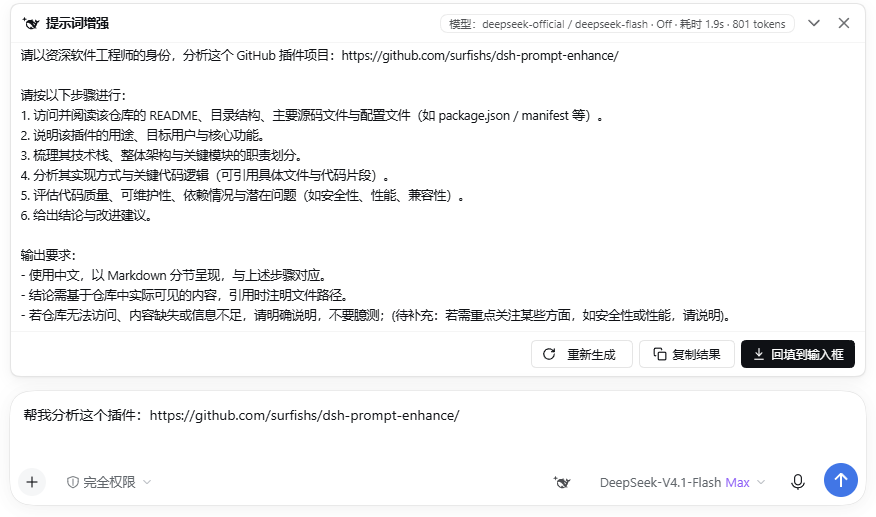

# dsh-prompt-enhance

[](https://github.com/surfishs/dsh-prompt-enhance/actions/workflows/ci.yml)
[](https://www.npmjs.com/package/@surfishs/dsh-prompt-enhance)
[](./LICENSE)

**DeepSeek Harness Web GUI 的「提示词增强」插件** —— 一键把输入框草稿改写为结构化提示词（角色与目标、可执行步骤、输出格式、验收标准、边界条件）。原文保留，失败不改草稿。

简体中文 | [English](./README.en.md)



---

## 功能

- **一键增强**：输入框工具栏的增强按钮（DeepSeek 鱼形标识 + 星芒）；快捷键默认关闭，可在设置中指定。原文保留，失败不改草稿。
- **停靠结果卡**：结果显示在输入框上方，不遮挡对话；附模型、耗时与 token 用量，可回填、复制、重新生成或撤销；发送消息时自动收起，`Esc` 关闭。
- **回填与撤销**：回填后结果卡保持打开并显示「已替换」，可直接撤销；关闭后输入框上方仍保留撤销条。
- **重新生成**：按当前输入框内容重新请求；回填后也可对增强稿再生成。
- **空输入灰态**：没有文字或只有附件时图标变浅，点击和快捷键都不发起请求。
- **截断提示**：输出达到 Token 上限时保留已生成内容，并提示结果可能不完整。
- **`/enhance <文本>`**：从斜杠面板改写任意文本，结果不进入模型历史。
- **模型路由**：设置成对覆盖 → 当前会话模型 → 全局默认模型，逐级回退。
- **上下文感知**：参考当前会话近况消解指代；可关闭。
- **配置热生效**：改完即用于下一次调用，无需重启。

## 环境要求

| | |
|---|---|
| dsh | `>= 0.1.1-rc.2 < 0.3.0` |
| Node（仅源码构建） | `^22.19.0 \|\| >=24.0.0` |
| 插件 | `0.0.x` |

## 安装

### 让 Agent 帮你安装

不用自己敲命令。把下面整段发给能操作本机终端的 Agent（DSH 桌面版、Web 版都可以）：

```text
帮我安装 DeepSeek Harness 插件 @surfishs/dsh-prompt-enhance。

1. 先确认我的 DSH profile 名：桌面版通常是 desktop，Web 版通常是 web；不确定就问我。
2. 执行：dsh plugin --profile <profile> add @surfishs/dsh-prompt-enhance
3. 如果 npm 安装失败，改用：dsh plugin --profile <profile> add github:surfishs/dsh-prompt-enhance
4. 安装完成后提示我重启 DSH，并让我确认插件出现在插件列表中。
5. 不要修改我的其他插件或 DSH 配置。
```

从 npm 安装：

```bash
dsh plugin --profile <profile> add @surfishs/dsh-prompt-enhance
# 重启 dsh
```

从 GitHub 安装（`lib/` 已随仓库提交，无需本地构建）：

```bash
dsh plugin --profile <profile> add github:surfishs/dsh-prompt-enhance
```

`<profile>` 换成你的 profile 名：桌面版通常是 `desktop`，Web 版通常是 `web`。

从本地检出（开发用）：

```bash
git clone https://github.com/surfishs/dsh-prompt-enhance.git
cd dsh-prompt-enhance && npm install && npm run build
dsh plugin --profile <profile> add link:C:\path\to\dsh-prompt-enhance
```

卸载：

```bash
dsh plugin --profile <profile> remove @surfishs/dsh-prompt-enhance
```

## 使用

1. **开始**：在输入框写下草稿，点工具栏的增强按钮（或你设置的快捷键）。
2. **查看结果**：结果出现在输入框上方的停靠卡里，可以：
   - **回填**：写回输入框，卡片保持打开并显示「已替换」；
   - **复制**：复制结果；
   - **重新生成**：按当前输入再生成一版。
3. **撤销**：回填后点「撤销」恢复；关闭卡片后，输入框上方仍保留撤销条。
4. **关闭**：发送消息时卡片自动收起，按 `Esc` 也可以关闭。

输入为空或只有附件时，按钮会变灰、不可点；超长或含引用块会被本地拒绝。输出达到 Token 上限时，会提示结果可能不完整。

`/enhance <文本>`：从斜杠面板改写任意文本，结果可复制，不进入模型历史。

## 配置

在 **设置 → 提示词增强**（或 插件面板 → `dsh-prompt-enhance` → **配置**）编辑。全部字段：

| 字段 | 默认 | 说明 |
|---|---|---|
| `enabled` | `true` | 总开关；关闭后隐藏输入框按钮，并停用命令与快捷键 |
| `provider` + `model` | 空 | 从 DSH 已注册的 LLM provider 及模型中选择；模型可选「自定义…」手填 ID；未配置的 provider 置灰、需先在 DSH 模型服务中配置；留空表示跟随当前会话模型（不指定）。只填一个时保存后按跟随会话处理 |
| `temperature` | `0.3` | 采样温度 `0~1`（步进 0.05），越低越忠实原文 |
| `reasoningEffort` | `off` | 档位由当前 provider/model 的声明决定；DeepSeek 为 `off` / `low` / `high` / `max`。未声明档位的路由会自动省略该字段（即跟随提供方默认）；`inherit` 表示不传该字段 |
| `maxOutputTokens` | `8192` | 单次调用的输出 token 上限 |
| `maxInputChars` | `12000` | 输入字符上限；超限拒绝，不截断 |
| `timeoutMs` | `60000` | 单次调用端到端超时（毫秒） |
| `systemPrompt` | 空 | 自定义系统提示词；留空使用内置增强策略 |
| `strategyMode` | `replace-default` | `replace-default` 整体替换内置策略（仍保留最小输出契约）；`extend-default` 把自定义策略追加在内置策略之后 |
| `shortcut` | 空（禁用） | 触发快捷键；例 `ctrl+alt+shift+e`。须包含 ctrl/alt/meta 中至少一个修饰键，shift 可选 |
| `streaming` | `true` | 边写边显示；仅影响显示节奏，最终结果不变 |
| `contextAware` | `true` | 读取最近对话以消解指代；含敏感内容的会话建议关闭 |
| `contextMaxMessages` | `8` | 参考的最近消息条数；`0` 表示不参考 |
| `contextMaxChars` | `4000` | 历史片段的字符预算；`0` 表示不参考 |
| `maxConcurrent` | `2` | 同时进行的增强上限；达到上限时新请求会提示稍后再试 |
| `rateLimitPerMinute` | `10` | 每分钟增强次数上限（滑动窗口）；超限时提示稍后再试 |

输入为空或只有附件时按钮灰掉，不发起请求；结果被截断时调高 `maxOutputTokens`。

## 安全

- **仅本机可访问**：增强路由由本机 DSH 宿主提供，只接受回环地址和本地 `Host` / `Origin`，不接受外部来源。
- **不保存模型密钥**：插件不读取或存储模型 API key，调用走宿主已有的 LLM 配置。
- **上下文按需发送**：`contextAware` 开启时，最近几轮 user/assistant 文本和当前草稿会发给当前配置的模型服务商（默认最多 8 条消息、4000 字符）；system、reasoning、工具结果和附件不会进入上下文。关闭后只发送草稿。
- **敏感会话**：如果内容不能外发，请关闭 `contextAware`，或改用你信任的本地/私有模型服务。

## 故障排查

| 现象 | 检查与处理 |
|---|---|
| 工具栏没有增强按钮 | 确认 `enabled` 为 `true`；安装后重启 DSH（桌面版或 `dsh web`）；确认当前 profile 正确。 |
| 按钮是灰的 | 输入框为空或只有附件；输入文字后恢复。 |
| 结果不完整 | 查看截断提示，并在设置中调高 `maxOutputTokens`。 |
| 提示「尚未确定增强用的模型」 | 在设置中成对填写 `provider` / `model`；或先在当前会话发一条消息，让插件跟随会话模型。 |
| 鉴权失败 | 检查对应 provider 在 DSH 中的凭据/API Key 是否有效。 |

## 开发

```bash
npm install
npm run typecheck
npm test
npm run build
```

详见 [CONTRIBUTING.md](./CONTRIBUTING.md)。

## 许可证

本项目采用 Apache-2.0，见 [LICENSE](./LICENSE)。

## 致敬

感谢 [rongxingda/dsh-prompt-enhance](https://github.com/rongxingda/dsh-prompt-enhance)：本项目的代码与设计建立在该项目（Apache-2.0）的基础之上。
